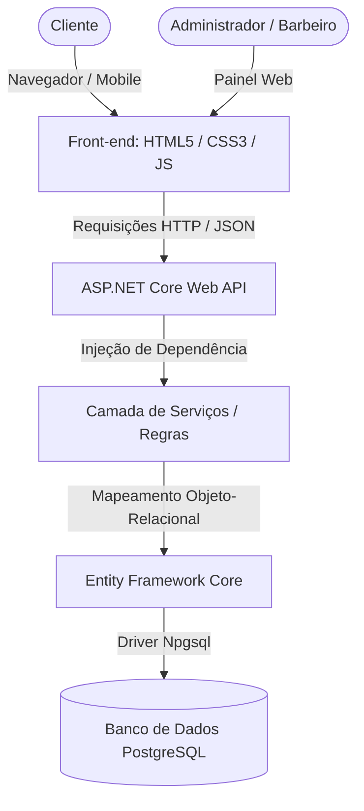
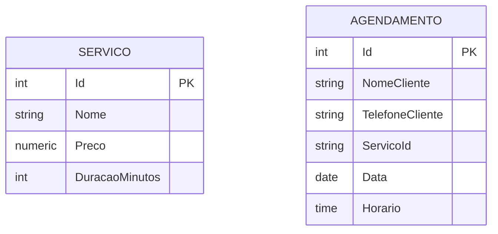

# Gueto Barbearia

> Sistema de agendamento desenvolvido para ajudar na organização dos clientes e horários da Gueto Barbearia.


---

## 📌 Sobre o projeto

Comecei este projeto com o objetivo de criar um sistema de agendamento simples e realmente útil para a barbearia de um amigo, a **Gueto Barbearia**.

A ideia não é fazer um sistema inchado ou cheio de funções desnecessárias, mas sim construir uma solução prática que facilite o agendamento dos clientes, auxilie na organização da agenda dos barbeiros e faça a diferença no dia a dia do estabelecimento.

Ao mesmo tempo, este projeto é a base prática dos meus estudos contínuos em desenvolvimento de software. Durante todo o processo, coloco em prática conceitos de front-end, C#, ASP.NET Core, APIs REST, banco de dados relacional (PostgreSQL), Entity Framework Core, Git e boas práticas de arquitetura Full Stack.

---

## 🚀 Status atual do desenvolvimento

O projeto saiu da fase de planejamento inicial e encontra-se em **desenvolvimento ativo**. 

### O que já foi realizado:
1. **Front-end Responsivo e Temas**:
   - Interface completa construída em HTML5 semântico e CSS3 com abordagem **mobile-first**.
   - Identidade visual da barbearia aplicada com fotos reais dos serviços e cortes.
   - **Suporte a temas dinâmicos (Modo Claro e Modo Escuro)** implementado via variáveis CSS e alternância por JavaScript.
   - Formulário de agendamento interativo com validações completas no cliente:
     - Bloqueio de datas passadas e de domingos (dias sem expediente).
     - Formatação e máscara automática para telefone/WhatsApp `(XX) XXXXX-XXXX`.
     - Validação de horários retroativos para a data corrente.
     - Resumo em tempo real do agendamento escolhido.

2. **Back-end e API REST (.NET 10)**:
   - Configuração do projeto ASP.NET Core Web API no .NET 10.
   - Implementação da camada de **Controllers** com rotas completas de CRUD:
     - `ServicosController`: Gerenciamento dos serviços prestados.
     - `AgendamentosController`: Criação, leitura, atualização e cancelamento de agendamentos.
   - Criação da camada de **Services** com injeção de dependência (`IServicos` / `ServicosService`, `IAgendamento` / `AgendamentoService`).
   - Documentação interativa e testes de endpoints configurados com **Swagger / OpenAPI**.

3. **Banco de Dados e ORM**:
   - Integração com **PostgreSQL** via driver `Npgsql.EntityFrameworkCore.PostgreSQL`.
   - Mapeamento das entidades no `GuetoDbContext`.
   - **EF Core Migrations** configuradas, com a migration inicial (`CriacaoBancoDados`) gerada para criação das tabelas `Servicos` e `Agendamentos`.

---

## 🎯 Problema que o sistema resolve

Sistemas de agendamento precisam lidar com situações cotidianas que vão além de apenas salvar um nome e um horário. Este projeto tem como meta eliminar gargalos reais da barbearia, tais como:

- Evitar que dois clientes agendem no mesmo horário com o mesmo profissional.
- Impedir reservas fora do expediente ou em dias de folga (como domingos).
- Adequar a grade de horários à duração real de cada serviço (ex: cortes rápidos vs. tranças/locs mais longos).
- Evitar confusões e perda de informações causadas por conversas manuais soltas no WhatsApp.
- Facilitar a visualização e gestão diária da agenda para o barbeiro.

---

## 🛠️ Tecnologias utilizadas

| Camada | Tecnologia | Finalidade | Situação |
|---|---|---|---|
| **Front-end** | HTML5 Semântico | Estruturação de conteúdo e acessibilidade | Implementado |
| **Front-end** | CSS3 Moderno | Layout responsivo, mobile-first e temas Claro/Escuro | Implementado |
| **Front-end** | JavaScript (ES6+) | Interatividade, máscaras, validações e consumo de API | Em andamento |
| **Back-end** | C# / ASP.NET Core Web API | Criação de controllers, services e regras de negócio | Implementado |
| **Plataforma** | .NET 10 | Runtime moderno e de alta performance | Implementado |
| **ORM** | Entity Framework Core 10 | Abstração de dados e versionamento via Migrations | Implementado |
| **Banco de Dados** | PostgreSQL | Armazenamento relacional de clientes, serviços e horários | Configurado |
| **Documentação** | Swagger / OpenAPI | Documentação e testes rápidos de endpoints HTTP | Implementado |
| **Segurança** | ASP.NET Core Identity | Proteção do painel administrativo e login | Planejado |
| **Testes** | xUnit | Testes unitários para regras críticas de negócio | Planejado |
| **Versionamento** | Git e GitHub | Controle de versão e histórico evolutivo | Em uso |

---

## 🏛️ Arquitetura do sistema



A aplicação foi desenhada para manter simplicidade e coesão:
- **`wwwroot`**: Contém o front-end servido diretamente pela aplicação, facilitando o deploy unificado.
- **`Controllers`**: Recebem requisições HTTP, delegam aos serviços e retornam respostas padronizadas com os devidos códigos de status HTTP (`200 OK`, `201 Created`, `204 NoContent`, `404 NotFound`).
- **`Services`**: Concentram a lógica de manipulação e regras de negócio.
- **`Data`**: Gerencia o contexto do Entity Framework (`GuetoDbContext`) e as migrações do banco de dados.

---

## 🔌 Endpoints da API

A documentação interativa completa pode ser visualizada via **Swagger** ao rodar a API no ambiente de desenvolvimento (`/swagger`).

### ✂️ Serviços (`/api/Servicos`)

| Método | Endpoint | Descrição |
|---|---|---|
| `GET` | `/api/Servicos` | Retorna a lista de todos os serviços cadastrados |
| `GET` | `/api/Servicos/{id}` | Retorna os detalhes de um serviço específico |
| `POST` | `/api/Servicos` | Cadastra um novo serviço |
| `PUT` | `/api/Servicos/{id}` | Atualiza dados de um serviço existente |
| `DELETE` | `/api/Servicos/{id}` | Exclui um serviço do catálogo |

### 📅 Agendamentos (`/api/Agendamentos`)

| Método | Endpoint | Descrição |
|---|---|---|
| `GET` | `/api/Agendamentos` | Retorna todos os agendamentos registrados |
| `GET` | `/api/Agendamentos/{id}` | Retorna os dados de um agendamento específico |
| `POST` | `/api/Agendamentos` | Cria um novo agendamento |
| `PUT` | `/api/Agendamentos/{id}` | Atualiza as informações de um agendamento |
| `DELETE` | `/api/Agendamentos/{id}` | Cancela/remove um agendamento |

---

## 🗄️ Modelo de dados

### Modelo atual no banco (Migration `CriacaoBancoDados`):



### Entidades em evolução para as próximas etapas:
- **Barbeiro**: Identificação dos profissionais que atendem na barbearia.
- **Jornada de Trabalho / Bloqueios**: Definição de horários de funcionamento, intervalos e bloqueio de datas/folgas.
- **Usuário / Admin**: Credenciais protegidas para gestão administrativa do estabelecimento.

---

## 📁 Estrutura de pastas

```text
gueto-barbearia/
├── src/
│   └── GuetoBarbearia.Api/
│       ├── Controllers/                    # Endpoints da API REST
│       │   ├── AgendamentosController.cs
│       │   └── ServicosController.cs
│       ├── Data/                           # Contexto e configurações do EF Core
│       │   └── GuetoDBContext.cs
│       ├── Migrations/                     # Histórico de migrações do banco
│       │   └── 20261016140434_CriacaoBancoDados.cs
│       ├── models/                         # Entidades de domínio (Models)
│       │   ├── Agendamento.cs
│       │   └── Servico.cs
│       ├── Services/                       # Interfaces e regras de negócio
│       │   ├── AgendamentoService.cs
│       │   ├── IAgendamento.cs
│       │   ├── IServicos.cs
│       │   └── ServicosService.cs
│       ├── Properties/
│       │   └── launchSettings.json
│       ├── wwwroot/                        # Arquivos estáticos servidos pelo front-end
│       │   ├── assets/
│       │   │   ├── CSS/
│       │   │   │   └── style.css           # Estilos e variáveis de tema
│       │   │   ├── images/                 # Fotos de cortes, serviços e logo
│       │   │   └── JS/
│       │   │       └── script.js           # Validações e manipulação do DOM
│       │   └── index.html                  # Landing page e formulário
│       ├── appsettings.json
│       ├── appsettings.Development.json
│       ├── GuetoBarbearia.Api.csproj
│       └── Program.cs                      # Configuração dos serviços e pipeline HTTP
└── README.md
```

---

## 💻 Como executar o projeto localmente

### Pré-requisitos
- [.NET 10 SDK](https://dotnet.microsoft.com/) instalado.
- [PostgreSQL](https://www.postgresql.org/) instalado e em execução (ou container Docker).
- Ferramenta de linha de comando do EF Core instalada globalmente:
  ```bash
  dotnet tool install --global dotnet-ef
  ```

### Passo a passo

1. **Clone o repositório:**
   ```bash
   git clone https://github.com/seu-usuario/gueto-barbearia.git
   cd gueto-barbearia
   ```

2. **Configure a string de conexão:**
   Defina a connection string do PostgreSQL utilizando o gerenciador de segredos do .NET ou no arquivo `appsettings.Development.json`:
   ```bash
   cd src/GuetoBarbearia.Api
   dotnet user-secrets set "ConnectionStrings:DefaultConnection" "Host=localhost;Port=5432;Database=gueto_db;Username=postgres;Password=sua_senha"
   ```

3. **Aplique as Migrations para criar as tabelas no PostgreSQL:**
   ```bash
   dotnet ef database update
   ```

4. **Execute a aplicação:**
   ```bash
   dotnet run
   ```

5. **Acesse no navegador:**
   - **Interface do Cliente:** `https://localhost:<porta>/index.html` (ou raiz da aplicação)
   - **Documentação Swagger:** `https://localhost:<porta>/swagger`

---

## 🗺️ Roadmap de evolução

- [x] Definir a ideia e o escopo do projeto.
- [x] Levantar os requisitos iniciais com o proprietário da barbearia.
- [x] Estruturar o layout semântico em HTML5.
- [x] Desenvolver o design responsivo mobile-first com CSS3.
- [x] Implementar alternância de temas (Modo Claro e Modo Escuro).
- [x] Criar formulário de agendamento com validações no front-end em JavaScript.
- [x] Configurar o projeto ASP.NET Core Web API no .NET 10.
- [x] Configurar o PostgreSQL e o Entity Framework Core com Migrations.
- [x] Implementar Controllers e Services para Gestão de Serviços e Agendamentos.
- [x] Configurar Swagger para documentação e testes dos endpoints.
- [ ] Conectar os Services à persistência definitiva no banco de dados via EF Core.
- [ ] Integrar o front-end com a API (consumir endpoints via Fetch API).
- [ ] Implementar cálculo de horários livres baseado em duração de serviços e agendamentos existentes.
- [ ] Desenvolver o painel de controle administrativo para o barbeiro.
- [ ] Implementar autenticação e autorização para a área administrativa.
- [ ] Escrever testes automatizados com xUnit.
- [ ] Publicar a aplicação em ambiente de produção (Deploy).

---

## 🎨 Identidade visual

A identidade visual é inspirada no perfil oficial da [Gueto Barbearia no Instagram](https://www.instagram.com/gueto_barbearia/), valorizando a cultura urbana, estética de cortes em degradê, tranças e locs:

- **Cores principais**: Preto grafite (`#111111` / `#1c1c1c`) e contrastes marcantes para o modo escuro; versão clara elegante no modo claro.
- **Cor de destaque**: Vermelho marcante (`#c01818`), conferindo dinamismo e personalidade.
- **Tipografia**: Combinação de fontes modernas (*Inter*, *Poppins*) e tipografia estilizada para títulos.
- **Imagens reais**: Fotos de alta qualidade de serviços autênticos realizados pelo barbeiro PH (Twists, Barrel Twists, Starter Locs, Cortes Disfarçados).

---

## 🎯 Objetivos de aprendizado

Este repositório documenta minha jornada prática rumo ao domínio de desenvolvimento Full Stack:

- **Front-end**: Manipulação de DOM, validações de formulário, design responsivo sem depender de frameworks pesados, temas dinâmicos via CSS.
- **Back-end com .NET**: Criação de APIs RESTful estruturadas, injeção de dependência, separação de responsabilidades (Controllers/Services).
- **Banco de Dados & ORM**: Modelagem relacional, scripts SQL, uso do Entity Framework Core com PostgreSQL e controle de versão de banco por Migrations.
- **Boas Práticas**: Organização de código, commits semânticos, versionamento com Git e documentação contínua de projeto.

---

> Projeto desenvolvido por **Arthur Torres**.  
> Criado para fins de aprendizado, portfólio e para gerar impacto real no negócio da Gueto Barbearia.
